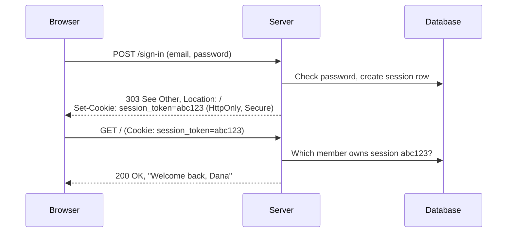
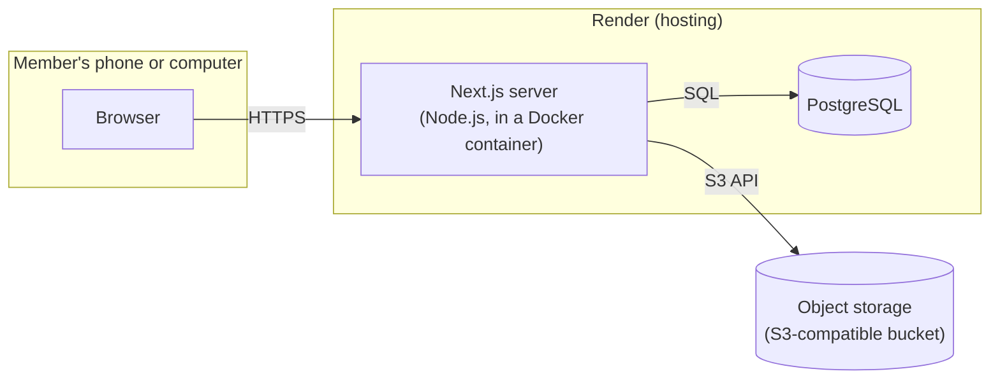

# Chapter 1. How the Web Actually Works

Frameworks are built to hide the plumbing, and that's mostly a good
thing. But when something breaks (a form submits twice, a user is
mysteriously signed out, a page shows yesterday's data) the plumbing is
where the answer is. This chapter is about the plumbing. Everything
later in the book is a convenience layered on top of what's here.

In this chapter you'll learn:

- What a browser and a server say to each other, in HTTP
- The three languages a browser understands: HTML, CSS and JavaScript
- Why HTTP has no memory, and how cookies give it one
- Where code runs in a modern web app, and why that matters
- How the pieces of Flight Club fit together

## A Conversation in Plain Text

When you open `https://flightclub.example.com/fleet`, your browser:

1. Looks up the IP address for `flightclub.example.com` using DNS, the
   internet's phone book.
2. Opens a TCP connection to that address, usually on port 443.
3. Negotiates TLS, which encrypts everything that follows and proves the
   server really is `flightclub.example.com` (that's what the certificate
   is for, and what the padlock means).
4. Sends an **HTTP request**.
5. Reads the **HTTP response**.

Steps 1–3 are infrastructure you'll rarely touch. Steps 4 and 5 are
what web development is about, and they're surprisingly simple. A
request is text:

```http
GET /fleet HTTP/1.1
Host: flightclub.example.com
Accept: text/html
Cookie: better-auth.session_token=abc123...
```

and so is a response:

```http
HTTP/1.1 200 OK
Content-Type: text/html; charset=utf-8
Cache-Control: private, no-store

<!DOCTYPE html>
<html lang="en">
  <head><title>Fleet · Flight Club</title></head>
  <body>...</body>
</html>
```

(Modern HTTP/2 and HTTP/3 encode this in binary for efficiency, but the
concepts, the methods, headers, status codes and bodies, are identical.)

You can have this conversation yourself. With the app running locally
(Chapter 2 shows how), try:

```sh
curl -i http://localhost:3000/api/health
```

```http
HTTP/1.1 200 OK
content-type: application/json
...

{"status":"ok","sha":"dev","database":"ok"}
```

That endpoint is used by the deployment pipeline in Chapter 14 to check
which version of the app is running. It's also a perfectly good first
example: a URL goes in, some data comes out.

### Methods

The first word of a request is its **method**, which says what the
client wants to do:

| Method                   | Meaning                                    | Example in Flight Club             |
| ------------------------ | ------------------------------------------ | ---------------------------------- |
| `GET`                    | Fetch something. Must not change anything. | Show the fleet page                |
| `POST`                   | Submit something that may change state     | Report a squawk                    |
| `PUT`, `PATCH`, `DELETE` | Replace, modify or remove a resource       | Used by APIs; rarely by HTML forms |

The rule that `GET` must not change anything is not a formality.
Browsers prefetch links, search engines crawl them, and users refresh
pages. If `GET /squawks/42/resolve` resolved a squawk, any of those
could resolve it by accident. In Flight Club, every change goes through
a `POST`.

### Status Codes

The response's first line carries a three-digit **status code**:

- **2xx** success: `200 OK`, `201 Created`, `204 No Content`
- **3xx** go elsewhere: `303 See Other`, `307 Temporary Redirect`
- **4xx** the client did something wrong: `400 Bad Request`,
  `401 Unauthorized` (meaning _not signed in_), `403 Forbidden`
  (_signed in, but not allowed_), `404 Not Found`
- **5xx** the server did something wrong: `500 Internal Server Error`,
  `503 Service Unavailable`

The distinction between 401 and 403 comes up in Chapter 7: someone who
isn't signed in should be sent to sign in, while someone who is signed
in but lacks a role should be told no.

### Headers

Headers carry everything about a request or response other than its
body. A few you'll meet repeatedly:

- `Content-Type` says what the body is (`text/html`, `application/json`,
  `image/jpeg`).
- `Cookie` (request) and `Set-Cookie` (response) carry cookies, covered
  below.
- `Location` tells the browser where to go on a redirect.
- `Cache-Control` says who may keep a copy of a response, and for how
  long. In Chapter 10 we'll mark squawk photos `private, max-age=31536000,
immutable`: only the member's own browser may keep them, and it may
  keep them for a year, because a photo never changes once uploaded.

## What the Browser Understands

A browser is, at heart, an interpreter for three languages:

**HTML** describes the _structure and meaning_ of a page: this is a
heading, this is a list, this is a form with a text field labeled
"What's wrong?".

```html
<form method="post" action="/squawks">
  <label for="description">What's wrong?</label>
  <textarea id="description" name="description"></textarea>
  <button type="submit">Report squawk</button>
</form>
```

That snippet is a complete, working form. With no JavaScript at all,
clicking the button sends a `POST /squawks` request whose body contains
`description=...`. This matters more than it looks: a well-built web
app works first as plain HTML and then gets better with JavaScript.
That approach is called **progressive enhancement**, and Next.js
supports it directly (Chapter 6).

**CSS** describes _presentation_: colors, spacing, layout, how things
change on a narrow screen or when printed. We'll write very little CSS
by hand, using Tailwind's utility classes instead (Chapter 3), but it's
all CSS underneath.

**JavaScript** adds _behavior_: responding to taps, updating part of a
page without reloading, shrinking a photo before uploading it. The
browser runs JavaScript in a sandbox. It can't read your files or open
arbitrary network connections, which is why some work must happen on a
server.

> [!NOTE]
> Accessibility starts with HTML. A `<button>` can be focused with the
> keyboard, announced by a screen reader, and activated with Enter or
> Space, for free. A `<div>` with a click handler can do none of that
> unless you rebuild it all yourself. Use the element that means what you
> mean. As a bonus, our end-to-end tests (Chapter 12) find elements the
> same way a screen reader does, by role and label, so accessible markup
> is also testable markup.

## HTTP Has No Memory

Every HTTP request stands alone. When a browser asks for `/fleet`, the
server has no inherent way to know that the same person signed in a
minute ago. This is called **statelessness**, and it's a feature: any
server can answer any request, which is what lets websites scale across
many machines.

But an app needs to know who you are. The standard solution is the
**cookie**: a small piece of data the server asks the browser to store
and send back with every subsequent request to the same site.



The cookie itself holds only a random, unguessable token. The server
looks it up in its own database to find out who it belongs to. Chapter
7 covers the details, including the cookie flags (`HttpOnly`, `Secure`,
`SameSite`) that stop it from being stolen or misused.

## Where Code Runs

In the early web, every page was generated on the server and every
click loaded a new page. Then came single-page applications, where the
server sent a mostly empty page and a large JavaScript program that
built everything in the browser. Both have problems: the first feels
slow and clunky; the second is slow to start, fragile on bad
connections, and pushes security-sensitive logic to where it can't be
trusted.

Modern frameworks like Next.js blend the two. Think of every piece of
code in the app as running in one of two places:

| On the server                             | In the browser                                |
| ----------------------------------------- | --------------------------------------------- |
| Can read the database, secrets and files  | Can respond instantly to taps and keystrokes  |
| Is trusted: users can't modify it         | Is untrusted: users can read and change it    |
| Sends finished HTML, so pages appear fast | Needs JavaScript downloaded and running first |
| Runs once per request                     | Runs on every user's device                   |

The guiding rule throughout this book:

> [!IMPORTANT]
> **The server is the only place where decisions are enforced.** The
> browser can _help_ (showing a live error as you type, hiding a button
> you can't use) but anything it does can be bypassed by anyone with
> the developer tools open or a copy of `curl`. Every rule that matters
> is checked again on the server.

You'll see this rule applied to validation (Chapter 6), permissions
(Chapter 7), and business rules (Chapter 8).

## The Shape of Flight Club

Here's the whole system, as it will look by the end of the book:



- The **browser** renders HTML, runs a little JavaScript, and talks
  only to our server.
- The **Next.js server** is a Node.js program. It renders pages, handles
  form submissions, checks permissions, and talks to everything else.
- **PostgreSQL** holds every record: members, aircraft, flights,
  squawks, maintenance.
- **Object storage** holds photos, which are too large and too numerous
  to keep in the database.

Notice that the browser never talks directly to the database or the
bucket. Everything goes through the server, which is where the
permissions live.

## Summary

- The web is a conversation of requests and responses in HTTP. Each has
  a method or status, headers, and an optional body.
- `GET` must never change anything; changes use `POST`.
- Browsers understand HTML (structure), CSS (presentation) and
  JavaScript (behavior). A good app works as HTML first.
- HTTP is stateless. Cookies carry a token that lets the server
  recognize a returning user.
- Code runs either on the trusted server or the untrusted browser.
  Every rule that matters is enforced on the server.

## Exercises

1. Open your browser's developer tools (usually F12), go to the
   Network tab, and load any website. Click on the first request. Find
   the method, status code, `Content-Type`, and any `Set-Cookie`
   headers.
2. Run `curl -i https://example.com`. Then try `curl -i
http://example.com`. What status code does the second one return,
   and what does its `Location` header say?
3. Write a plain HTML file with a form that `GET`s
   `https://www.google.com/search` with a text field named `q`. Open
   it in a browser and submit it. You've just built a search interface
   with no JavaScript.

**Next:** [Chapter 2. The Toolchain](02-the-toolchain.md)
