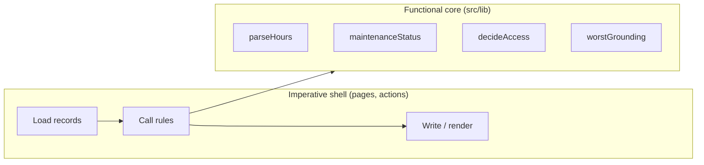

# Chapter 8. Rules Without Frameworks

By now you've seen the frameworks: React renders, Next.js routes, Drizzle
queries, Better Auth signs people in. None of them knows that an annual
inspection is due at the end of the calendar month, that a meter's in
reading must exceed its out reading, or that a squawk that grounds an
aircraft can't simply be deferred. Those rules are _the application_.
Everything else is plumbing.

This chapter is about where to put those rules so they're easy to
understand, easy to test, and impossible to bypass.

In this chapter you'll learn:

- Why business rules belong in plain functions with no framework in them
- How to do exact arithmetic on decimal quantities
- How to work with dates without time zone bugs
- How to compute derived state such as "airworthy" and "due soon"
- How to unit test with Vitest
- How one rule can serve both live feedback in the browser and
  enforcement on the server

## The Shape: a Functional Core

Flight Club's `src/lib/` directory contains files like `hours.ts`,
`grounding.ts`, `maintenance.ts`, `qualifications.ts`,
`flight-rules.ts` and `access.ts`. Each starts with a comment like this
one:

```ts
// Rules for logging and editing flights (docs/spec.md, section 6).  Kept
// free of the database and React so they can be unit tested and shared by
// the form's live feedback and the server action that enforces them.
```

These modules import nothing from Next.js, React, Drizzle or the
network. They take plain values and return plain values. Pages and
actions do the I/O: they load records from the database, call these
functions, and act on the result.



This is sometimes called "functional core, imperative shell." The
benefits are concrete:

- **Testable in milliseconds.** No database to set up, no server to
  start. A test passes in values and checks the result.
- **Readable.** Someone wanting to know how due dates work reads one
  file, not a tangle of queries and components.
- **Shareable.** Code that doesn't touch the server can run in the
  browser too, for instant feedback as the user types.

## Exact Arithmetic

Chapter 4 explained why meter readings are stored as `numeric(9, 2)`
and Chapter 5 that Drizzle returns them as strings. Now we need to do
arithmetic on them. The trick is to convert to **integer hundredths**,
where arithmetic is exact, and back to strings only for display and
storage:

```ts
// src/lib/hours.ts
// Meter readings are hours to two decimal places.  Arithmetic happens in
// integer hundredths so 0.1 + 0.2 never comes out as 0.30000000000000004;
// decimal strings are only for display and the database.

// What a meter column can hold: numeric(9, 2).
const READING = /^(\d{1,7})(?:\.(\d{1,2}))?$/;

// Parse what a pilot typed, or what Postgres returned, into hundredths.
// Returns null for anything that isn't a plain non-negative reading.
export function parseHours(input: string): number | null {
  const match = READING.exec(input.trim());
  if (!match) return null;
  const [, whole, fraction = ""] = match;
  return Number(whole) * 100 + Number(fraction.padEnd(2, "0"));
}

// Two decimals, as the database stores them: 123456 → "1234.56".
export function toHours(hundredths: number) {
  return (hundredths / 100).toFixed(2);
}

// For display: meters show tenths, so trailing zeros only add noise.
export function formatHours(hundredths: number) {
  const fixed = toHours(hundredths);
  return fixed.endsWith("0") ? fixed.slice(0, -1) : fixed;
}
```

Notice that `parseHours` parses the string itself, digit by digit,
rather than calling `parseFloat`. `parseFloat("1234.56")` produces the
nearest binary float, and multiplying by 100 may give `123455.99999999999`.
Parsing the parts as integers sidesteps floats entirely. The regular
expression also enforces the database's limits (seven digits, two
decimals), so anything it accepts can be stored.

Treat money the same way: integer cents, converted only at the edges.

## Dates Without Tears

Dates in JavaScript are notoriously treacherous. The `Date` object
represents an instant, and most of its methods silently use the
_server's local time zone_. A flight "on 2026-10-14" can become
"2026-10-13" when it passes through `new Date()` on a machine in a
western time zone.

Flight Club's rule: **calendar dates are ISO strings (`"2026-10-14"`),
and any `Date` arithmetic on them happens in UTC.** For example,
"calendar months" as the FAA counts them for annual inspections:

```ts
// src/lib/maintenance.ts (excerpt)
// Calendar months, as the FAA counts them for annuals, ELTs, transponders
// and the like: done any day in March, 12 calendar months makes it due at
// the end of March the next year.
export function dueDate(lastCompletedOn: string, months: number) {
  const [year, month] = lastCompletedOn.split("-").map(Number);
  // Day 0 of the month after the target is the target's last day.
  const end = new Date(Date.UTC(year, month - 1 + months + 1, 0));
  return end.toISOString().slice(0, 10);
}
```

`Date.UTC` builds an instant from UTC parts, and `toISOString` reads it
back in UTC, so the server's zone never enters into it.

Some aviation dates aren't calendar arithmetic at all. Navigation
databases are published on the **AIRAC cycle**: a new one every 28
days, forever, starting from a fixed date. So "when does this database
expire?" is a count of 28-day steps from an epoch, which makes a nice
small pure module:

```ts
// src/lib/airac.ts (excerpt)
// Cycle 2001 took effect on 2 January 2020; each is named for the
// year it takes effect in and its place in that year, so most years have
// 13 and a few, like 2020, have 14.
const EPOCH = Date.UTC(2020, 0, 2);

const indexOn = (isoDate: string) =>
  Math.floor((Date.parse(`${isoDate}T00:00:00Z`) - EPOCH) / (CYCLE_DAYS * DAY));
```

The naming rule (cycle "2014" exists; "2614" doesn't) is exactly the
kind of thing to pin down with a few unit tests taken from published
cycle dates, before any page depends on it.

Times that a _person_ reads, like "reported at 3:42 PM," are a different
matter: those should be shown in the _viewer's_ time zone, which only
the browser knows. Chapter 9 handles that with a small Client Component.

> [!NOTE]
> JavaScript's new `Temporal` API fixes most of `Date`'s problems, with
> distinct types for plain dates, instants and zoned times. Where it's
> available, prefer it. The principle is the same either way: keep
> calendar dates and instants as different types, and be explicit about
> zones.

## Derived State

Chapter 4 argued for computing conclusions rather than storing them.
Here's what that looks like. Each open squawk and each overdue
maintenance item _grounds_ an aircraft at some level, and the aircraft's
status is the most restrictive of them:

```ts
// src/lib/grounding.ts
export const GROUNDING_LEVELS = ["none", "ifr", "all"] as const;
export type Grounding = (typeof GROUNDING_LEVELS)[number];
export type AircraftStatus = "airworthy" | "vfr-only" | "grounded";

export function worstGrounding(levels: Iterable<Grounding>): Grounding {
  let worst: Grounding = "none";
  for (const level of levels) {
    if (GROUNDING_LEVELS.indexOf(level) > GROUNDING_LEVELS.indexOf(worst))
      worst = level;
  }
  return worst;
}

export function statusFor(level: Grounding): AircraftStatus {
  return level === "all"
    ? "grounded"
    : level === "ifr"
      ? "vfr-only"
      : "airworthy";
}
```

The ordering of `GROUNDING_LEVELS` _is_ the severity order, so there's
one definition to maintain.

Maintenance status is richer: an item may be due by calendar time, by
hours on a meter, or whichever comes first, and is "due soon" within a
window scaled to its interval:

```ts
// src/lib/maintenance.ts (excerpt)
// `today` is an ISO date.  With both intervals, whichever comes first
// decides.
export function maintenanceStatus(
  item: MaintenanceInput,
  today: string,
): MaintenanceStatus {
  const status: MaintenanceStatus = { state: "ok" };
  // ... calendar: compute dueOn and daysLeft; overdue if negative,
  //     due-soon within min(30 days, a quarter of the interval) ...
  // ... hours: compute dueAt and hoursLeft the same way ...
  return status;
}
```

Notice that `today` is a _parameter_. The function doesn't call
`new Date()` itself. That small choice is what makes it testable: a test
can ask "what's the status on the day it's due?" without waiting for
that day or faking the system clock. Any function that depends on the
current time, a random number, or the environment should take it as an
argument.

The shell then combines these: `aircraftAlerts()` in `src/lib/fleet.ts`
loads open squawks and maintenance items for a set of aircraft, runs
each item through `maintenanceStatus`, collects grounding levels, and
asks `worstGrounding` for the verdict. That one function feeds the fleet
page, the home page, the check-out warnings, and the check-out action's
refusal to dispatch a grounded aircraft. One rule, one answer,
everywhere.

## Unit Testing with Vitest

**Vitest** runs tests written in TypeScript, quickly, with an API that
will be familiar from any xUnit-style framework. Tests live beside the
code they test, as `*.test.ts`:

```ts
// src/lib/hours.test.ts
import { describe, expect, it } from "vitest";
import { formatHours, parseHours, toHours } from "./hours";

describe("parseHours", () => {
  it.each([
    ["1234", 123400],
    ["1234.5", 123450],
    ["1234.56", 123456],
    ["0.1", 10],
    [" 12.3 ", 1230],
  ])("parses %j", (input, expected) => {
    expect(parseHours(input)).toBe(expected);
  });

  it.each(["", "abc", "-1", "1.234", "1,234.5", ".5", "1.", "12345678", "1e3"])(
    "rejects %j",
    (input) => {
      expect(parseHours(input)).toBeNull();
    },
  );

  it("adds without float error", () => {
    expect(parseHours("0.1")! + parseHours("0.2")!).toBe(parseHours("0.3"));
  });
});
```

`it.each` runs one test per row, which makes a table of cases, valid and
invalid, easy to read and extend. The rejection list is a catalogue of
what real people type: commas, trailing dots, exponents.

Date rules get the edge cases that bite in practice:

```ts
// src/lib/maintenance.test.ts (excerpt)
describe("dueDate", () => {
  it("handles short months and leap years", () => {
    expect(dueDate("2027-02-10", 12)).toBe("2028-02-29");
    expect(dueDate("2026-11-30", 3)).toBe("2027-02-28");
  });
});

describe("maintenanceStatus by date", () => {
  const annual = { ...none, intervalMonths: 12, lastCompletedOn: "2025-12-03" };

  it("is still due, not overdue, on the due date", () => {
    expect(maintenanceStatus(annual, "2026-12-31")).toMatchObject({
      state: "due-soon",
      daysLeft: 0,
    });
  });
});
```

And permissions get the full matrix, because a mistake there is a
security bug:

```ts
// src/lib/access.test.ts (excerpt)
it("holds inactive members at pending, whatever their tags", () => {
  expect(decideAccess(pending, "active")).toBe("pending");
  expect(decideAccess(deactivatedOfficer, "officer")).toBe("pending");
});
```

Run them with:

```sh
pnpm test         # once
pnpm test:watch   # re-run on every save
```

The configuration is minimal; it only needs to know about the `@/`
path alias:

```ts
// vitest.config.mts
export default defineConfig({
  resolve: { alias: { "@": path.resolve(import.meta.dirname, "src") } },
  test: { include: ["src/**/*.test.ts"], environment: "node" },
});
```

> [!TIP]
> Write the test name as a sentence about the domain: "is still due, not
> overdue, on the due date." When it fails a year from now, the name
> tells whoever's reading it which rule broke, in words a club officer
> would recognize.

## One Rule, Two Places

`checkReading` validates a meter's in reading against its out reading:

```ts
// src/lib/flight-rules.ts (excerpt)
export function checkReading(
  out: number,
  typed: string,
  inHundredths: number | null,
): ReadingCheck {
  if (typed.trim() === "") return { status: "empty" };
  if (inHundredths === null)
    return { status: "invalid", message: "Enter a reading like 1234.5." };
  if (inHundredths <= out)
    return { status: "invalid", message: "Must be more than the out reading." };
  const duration = inHundredths - out;
  if (duration > LONG_FLIGHT_HUNDREDTHS) {
    return {
      status: "ok",
      duration,
      warning: `That's ${(duration / 100).toFixed(1)} hours. Did you mean to log that much?`,
    };
  }
  return { status: "ok", duration };
}
```

The check-in form calls it on every keystroke to show the flight's
duration live, and to warn about a probable typo ("That's 12.0 hours.
Did you mean to log that much?") before the pilot submits. The check-in
action calls the _same function_ on the server to enforce it. The
browser's call is a convenience; the server's is the guarantee. Because
they share code, they can't disagree about what's valid.

That's only possible because the function has no server dependencies.
A rule module that imported the database couldn't be sent to the
browser at all.

## What Not to Unit Test

Unit tests are for logic. Don't write unit tests that mock the database
to check that a query was "called with the right arguments": they test
your mocks, not your app, and break on every refactor. Instead:

- Put logic in pure functions and unit test those thoroughly.
- Let the database enforce invariants with constraints.
- Test the whole system, through the browser, with end-to-end tests
  (Chapter 12).

## Summary

- Keep business rules in plain modules with no framework, database or
  network dependencies. Pages and actions do the I/O around them.
- Do exact arithmetic in integers (hundredths of an hour, cents), and
  convert to decimal strings only at the edges.
- Represent calendar dates as ISO strings and compute in UTC; show
  instants in the viewer's zone.
- Derive status from facts. Pass "now" in as a parameter.
- Unit test rules with Vitest, using tables of cases and domain-language
  names.
- The same rule can give live feedback in the browser and be enforced on
  the server.

## Exercises

1. Add a case to `hours.test.ts` for the input `"0001.5"`. Should it be
   accepted? Run the tests and decide whether the code or your
   expectation is wrong.
2. Read `src/lib/qualifications.ts`. Write a test for a flight review
   done on the last day of a month. When does it expire?
3. Find every caller of `worstGrounding` in the project (`grep -rn
worstGrounding src`). How many different pages depend on it?

**Next:** [Chapter 9. Interactive Interfaces](09-interactive-interfaces.md)
