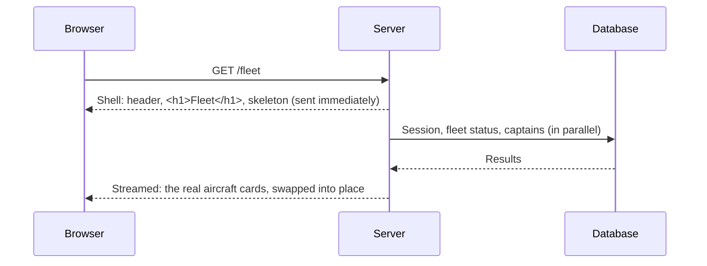

# Chapter 11. Rendering, Streaming and Caching

A page that's correct but slow feels broken, especially on a phone with
two bars of signal. This chapter is about what happens between a request
arriving and the last byte of HTML leaving: what can be prepared ahead
of time, what must wait for the request, how to send the first part of a
page before the rest is ready, and which things are safe to cache. It's
also about the most dangerous performance optimization of all: caching
something that should never have been cached.

In this chapter you'll learn:

- The difference between static and dynamic rendering
- How Next.js prerenders a page's shell and streams in the rest
- How `<Suspense>` boundaries and fallbacks work
- What to cache, for how long, and what never to cache
- How to avoid slow queries: parallelism and the N+1 problem
- What the client-side router keeps, and why

## Static Versus Dynamic

Some HTML is the same for everyone: the sign-in page, the site's
header frame, the outline of the fleet page. It can be rendered once,
at build time, and served instantly. That's **static rendering**.

Other HTML depends on the request: _who_ is signed in, _which_ aircraft
is in the URL, _what's_ in the database right now. It must be rendered
per request. That's **dynamic rendering**.

Most real pages are a mix. The fleet page's heading and layout are
static; the list of aircraft and their status is dynamic. Rendering the
whole page dynamically means the user sees nothing until the slowest
query finishes. Rendering it statically would show stale, or worse,
someone else's, data.

## Prerendered Shells and Streaming

Next.js resolves this with **Cache Components**, enabled in
`next.config.ts`:

```ts
const nextConfig: NextConfig = {
  output: "standalone",
  cacheComponents: true,
  // ...
};
```

With it on, Next.js prerenders as much of each page as it can at build
time (the **static shell**) and leaves holes for the dynamic parts. At
request time, the server sends the shell immediately, then **streams**
each dynamic part into its hole as it becomes ready, all in the same
HTTP response.

You mark the holes with React's `<Suspense>`:

```tsx
// src/app/(member)/fleet/page.tsx (excerpt)
export default function FleetPage() {
  return (
    <div className="wide flex flex-col gap-6">
      <h1 className="text-2xl font-semibold tracking-tight">Fleet</h1>
      <Suspense fallback={<ListSkeleton rows={3} tall />}>
        <Fleet />
      </Suspense>
    </div>
  );
}

async function Fleet() {
  const member = await requireMember();
  const [fleet, resolved, maintained] = await Promise.all([
    fleetStatus(),
    recentlyResolved(),
    maintainedAircraft(member),
  ]);
  // ... render the cards ...
}
```

The `<h1>` and the `ListSkeleton` (a few grey placeholder boxes) are in
the static shell. The moment a member taps "Fleet," they see the heading
and the skeleton; a fraction of a second later the real cards replace
it.



### What Makes Something Dynamic

Code becomes dynamic when it touches request-time data:

- `headers()` and `cookies()` from `next/headers` (reading the session
  does this)
- `params` and `searchParams` (they're Promises for this reason)
- `connection()` from `next/server`, which says explicitly "this needs a
  real request" (the health check uses it, because the deployed commit
  and database status are runtime facts)
- Uncached database queries and `fetch` calls

With Cache Components on, **dynamic code must sit inside a `<Suspense>`
boundary** (or be explicitly cached). If it isn't, Next.js reports an
error in development and the build fails, rather than silently making
the whole page dynamic. That's why you'll see the same shape throughout
Flight Club: a synchronous page component that renders the static
frame, and an async inner component, wrapped in `<Suspense>`, that reads
the session and the data.

The member layout applies the same idea to the header: the logo and
frame are static, and the part that depends on who's signed in (tabs,
account menu) streams in:

```tsx
// src/components/site-header.tsx (excerpt)
<header className="sticky top-0 z-40 border-b ...">
  <Link href="/">
    <BrandMark /> Flight Club
  </Link>
  {/* Reads the session, so it streams in after the static shell. */}
  <Suspense fallback={null}>
    <HeaderNav />
  </Suspense>
</header>
```

> [!TIP]
> Choose fallbacks that have the same size as what they replace. A
> skeleton that's much shorter than the real content makes the page jump
> when the content arrives, which is disorienting and can make someone
> tap the wrong thing.

### Error Handling Still Works

A `forbidden()`, `notFound()` or `redirect()` thrown inside a streamed
component still produces the right result. If the shell has already been
sent, Next.js handles redirects by instructing the browser to navigate,
and renders the forbidden or not-found page in place. You write the
guards the same way regardless.

## Caching: Powerful and Dangerous

**Caching** means keeping a computed result to reuse instead of
recomputing it. Done well, it makes apps fast. Done carelessly, it
serves one member's data to another, or shows a grounded aircraft as
airworthy because the status was cached before the squawk was reported.

Next.js offers a `"use cache"` directive that caches a function's or
component's result across requests, with a lifetime set by
`cacheLife()`:

```ts
import { cacheLife } from "next/cache";

async function clubAnnouncements() {
  "use cache";
  cacheLife("hours");
  return db().select().from(announcement);
}
```

Flight Club, notably, **doesn't use `"use cache"` for any of its data**.
Every page shows information that must be current (an aircraft's status,
who has it checked out, whether a squawk is resolved) and nearly
everything depends on who's asking. The database answers these queries
in milliseconds. Caching would add risk and save almost nothing.

That's a deliberate decision, and a good default:

> [!IMPORTANT]
> Don't cache until you've measured a problem. When you do cache, ask:
> (1) Is this the same for everyone who might receive it? (2) What's the
> cost of showing a stale value, and for how long is that acceptable?
> (3) What invalidates it? If you can't answer all three, don't cache it.

### Per-Request Memoization

There is one kind of caching that's always safe: remembering a result
_within a single request_. React's `cache()` does that:

```ts
// src/lib/session.ts
export const getCurrentMember = cache(async () => {
  /* ... */
});

// src/lib/captains.ts
export const captainOf = cache(async (memberId: string) => {
  /* ... */
});
```

The header, the page, and several components can each call
`getCurrentMember()`; the session is looked up once. When the next
request arrives, the cache is empty again, so a deactivated member is
locked out immediately.

### HTTP Caching

Responses can also be cached by browsers and by CDNs, controlled with
the `Cache-Control` header (Chapter 1). Next.js sets sensible headers on
pages (dynamic pages aren't cached by shared caches) and on its built
JavaScript and CSS (cached forever, because their filenames contain a
hash of their content and change whenever they do). When you write your
own route handlers, set it yourself, as the photo route does:
`private` for anything personal, and `immutable` only for things that
truly never change.

## Making Queries Fast

Most slow pages are slow because of how they query the database.

**Run independent queries in parallel.** These three don't depend on
each other, so they run at once:

```ts
const [fleet, resolved, maintained] = await Promise.all([
  fleetStatus(),
  recentlyResolved(),
  maintainedAircraft(member),
]);
```

Writing three sequential `await`s would make the page wait for the sum
of their times rather than the longest.

**Avoid N+1 queries.** The classic mistake is a loop that queries once
per item:

```ts
// Slow: one query for the aircraft, then one more per aircraft.
for (const plane of planes) {
  plane.squawks = await db()
    .select()
    .from(squawk)
    .where(eq(squawk.aircraftId, plane.id));
}
```

With ten aircraft that's eleven round trips. Instead, fetch all the
related rows in one query and group them in code:

```ts
// src/lib/fleet.ts takes a list of ids and asks once:
.where(and(inArray(squawk.aircraftId, aircraftIds), eq(squawk.status, "open")))
```

Drizzle's relational queries (`with: { meters: true }`) also fetch
related rows efficiently.

**Index what you filter on** (Chapter 4), and when a query is slow,
ask PostgreSQL why with `EXPLAIN ANALYZE`.

## The Client-Side Router

Once a page has loaded, navigating with `<Link>` doesn't fetch a whole
new HTML document. The router fetches just the new page's content and
swaps it in, keeping the layout (and the header's state) intact. It
also **prefetches**: when a link scrolls into view, the router fetches
that page's static shell in advance, so tapping it shows something
instantly. (`partialPrefetching: true` in `next.config.ts` limits that
prefetch to the shell, so it doesn't run the dynamic parts, and their
queries, for every link on screen.)

To make the browser's back and forward buttons instant, the router also
**keeps recently visited pages alive but hidden**, using React's
`<Activity>`, rather than throwing them away. Two consequences are worth
knowing:

- A page you navigate back to may briefly show what it showed before,
  then refresh. After a Server Action, the redirect fetches the
  destination fresh, so results of your own changes always appear.
- Hidden pages are still in the DOM. In end-to-end tests (Chapter 12),
  locating elements by role, which ignores hidden content, avoids
  accidentally matching a field on a page you navigated away from.

## Summary

- Static rendering happens once; dynamic rendering happens per request.
  Most pages are both.
- With Cache Components, Next.js prerenders a static shell and streams
  dynamic parts into `<Suspense>` boundaries. Dynamic code must be
  inside one.
- Use fallbacks that match the final layout.
- Cache across requests only when you've measured a need and can say
  who it's for, how stale is acceptable, and what invalidates it.
  Per-request memoization with `cache()` is always safe.
- Run independent queries in parallel, avoid N+1 queries, and index
  what you filter on.
- The client router prefetches shells and keeps recent pages alive for
  instant back and forward navigation.

## Exercises

1. Load the fleet page with the browser's network throttling set to
   "Slow 4G." Watch the skeleton appear and be replaced. Then remove the
   `<Suspense>` wrapper and see what `pnpm dev` says.
2. Find a page that makes several `await`ed queries in sequence. Could
   any run in parallel?
3. Run `EXPLAIN ANALYZE` in `psql` on a query that lists one aircraft's
   flights by date. Is it using `flight_aircraft_date_idx`?

**Next:** [Chapter 12. Testing It Like a User](12-testing-it-like-a-user.md)
