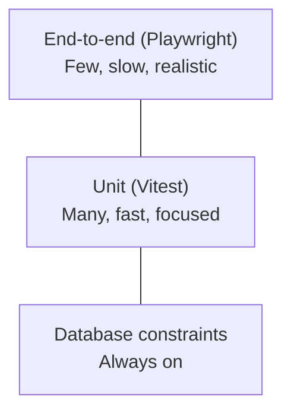

# Chapter 12. Testing It Like a User

Unit tests (Chapter 8) prove that the rules are right. They can't prove
that the sign-in form actually signs you in, that the check-out button
is reachable on a phone, or that a pilot really gets a 403 on the
members page. For that, you need tests that drive a real browser against
the real app and real database, the way a member would. This chapter
builds them with Playwright.

In this chapter you'll learn:

- What end-to-end tests are for, and what they cost
- How to write Playwright tests that find elements the way users do
- How to run the same tests at phone, tablet and desktop sizes
- How to keep parallel tests from interfering with each other
- How to deal with the sources of flaky tests

## The Testing Pyramid, Briefly



Unit tests are cheap: thousands run in seconds. End-to-end tests are
expensive: each starts a browser, signs someone up, clicks through
pages, and waits for the server. So the balance is many unit tests for
the logic, and end-to-end tests for each important _journey_: signing
up and being approved, checking out and in, reporting and resolving a
squawk, logging maintenance, the permission boundaries. Flight Club has
about twenty spec files under `e2e/`, one per feature.

## Your First Playwright Test

```ts
// e2e/settings.spec.ts (excerpt)
import { expect, test } from "@playwright/test";
import { closeSql, signUpPilot, sql } from "./helpers";

test.afterAll(async () => {
  await closeSql();
});

test("a member changes their name", async ({ page }, testInfo) => {
  const me = await signUpPilot(page, testInfo);
  await page.goto("/");
  await page.getByRole("button", { name: "Account" }).click();
  await page.getByRole("link", { name: "Settings" }).click();

  const name = `Renamed ${me.name}`;
  await page.getByLabel("Name").fill(name);
  await page.getByRole("button", { name: "Save name" }).click();
  await expect(page.getByText("Name saved.")).toBeVisible();
  await expect(page.getByLabel("Name")).toHaveValue(name);

  // And the change was audited.
  const [entry] = await sql()`
    select a.after from audit_log a join member m on m.id = a.entity_id
    where m.email = ${me.email} and a.action = 'member.update'
  `;
  expect(entry.after).toEqual({ name });
});
```

Read it aloud and it describes what a person does: open the account
menu, choose Settings, type a new name, save, see a confirmation. That's
the goal.

### Locators: Find Things the Way Users Do

Notice what the test _doesn't_ do: it never uses CSS selectors like
`#name-input` or `.btn-primary`. It finds things by **role and
accessible name** (`getByRole("button", { name: "Save name" })`), by
**label** (`getByLabel("Name")`), or by visible **text**. Those are how
a person, or a screen reader, finds things.

Two benefits follow:

- Tests don't break when you restyle or restructure markup. They break
  when the _user-visible_ behavior changes, which is when they should.
- If a test can't find a button by its role and name, a screen reader
  user can't either. Accessible markup and testable markup are the same
  thing.

### Assertions That Wait

Web pages update asynchronously. After clicking "Save name," the
confirmation appears only once the action has run and the page has
re-rendered. Playwright's `expect(...).toBeVisible()` **retries** until
the condition holds or a timeout expires, so you never write `sleep(2)`.
Likewise, actions like `click()` wait for the element to be visible,
enabled, and stable before clicking.

For conditions outside the page, like a database row eventually being
written, `expect.poll` retries a function:

```ts
await expect
  .poll(async () => {
    const [row] =
      await sql()`select last_seen_release_note as seen from member where email = ${me.email}`;
    return row.seen;
  })
  .toBe(LATEST_RELEASE_NOTE);
```

## Every Device, Every Test

Members mostly use phones, so phones are first-class targets. The
Playwright config defines four **projects**, each a device profile, and
runs every test in each:

```ts
// playwright.config.ts (excerpt)
export default defineConfig({
  testDir: "./e2e",
  globalSetup: "./e2e/warm-up.ts",
  fullyParallel: true,
  retries: isCI ? 2 : 0,
  use: { baseURL: `http://localhost:${port}`, trace: "on-first-retry" },
  // Members mostly use phones on the ramp, so phone and tablet sizes are
  // first-class targets alongside desktop.
  projects: [
    { name: "iphone", use: { ...devices["iPhone 17"] } },
    { name: "android", use: { ...devices["Pixel 9"] } },
    { name: "ipad", use: { ...devices["iPad (gen 11)"] } },
    { name: "desktop", use: { ...devices["Desktop Chrome"] } },
  ],
  webServer: {
    // CI tests the production build; locally the dev server is quicker to
    // iterate against.
    command: isCI ? "pnpm start" : `pnpm dev --port ${port}`,
    url: `http://localhost:${port}/api/health`,
    reuseExistingServer: !isCI,
  },
});
```

Device profiles set the viewport size, pixel density, touch support,
and user agent, and the iPhone profile runs in WebKit, Safari's engine.
A layout bug that only appears on a 360px-wide Android screen, or a
Safari-only quirk, fails the build.

`webServer` starts the app before the tests and waits until the health
endpoint responds.

## Isolation: Tests That Don't Collide

With `fullyParallel: true`, many tests run at once, across four device
projects, _against one database_. If two tests both used "N12345" or
"pilot@example.com," they'd trample each other. The rule:

> [!IMPORTANT]
> Every test creates its own data, with unique names, and cleans up
> after itself. No test depends on another test, on the order tests run
> in, or on seed data.

Helpers make that easy:

```ts
// e2e/helpers.ts (excerpt)
// Unique per test and per project, since every device project runs the
// whole suite against the same database.
export function uniqueId(testInfo: TestInfo) {
  return `${testInfo.project.name}-${Date.now()}-${Math.random().toString(36).slice(2, 8)}`;
}

// A signed-in, approved member of the test's own, a pilot unless other
// roles are given.
export async function signUpPilot(
  page: Page,
  testInfo: TestInfo,
  roles: string[] = ["pilot"],
) {
  const pilot = newMember(testInfo);
  await signUp(page, pilot);
  await expect(page.getByRole("status")).toBeVisible(); // "waiting for approval"
  approve(pilot.email, ...roles); // runs the approve-member script
  return pilot;
}
```

Tests that need an aircraft create one, with a unique tail number,
directly in the database, and delete it afterwards:

```ts
// e2e/maintenance-kinds.spec.ts (excerpt)
test.beforeEach(async ({ page }, testInfo) => {
  aircraft = await createAircraft(
    testInfo,
    { hobbs: "500.00", tach: "400.00" },
    "hobbs",
  );
  await signUpPilot(page, testInfo, ["officer", "pilot"]);
});

test.afterEach(async () => {
  await deleteAircraft(aircraft.id);
});
```

Setting up preconditions directly in the database is fine, and much
faster than clicking through the officer screens every time. The
_behavior under test_ is always exercised through the browser.

## Testing Permissions

Permission tests are among the most valuable end-to-end tests, because
they check the server's enforcement, not just what the UI offers:

```ts
// e2e/aircraft.spec.ts (excerpt)
test("pilots can't manage aircraft", async ({ browser }, testInfo) => {
  // A browser of their own: the page fixture is signed in as an officer.
  const context = await browser.newContext();
  const page = await context.newPage();
  await signUpPilot(page, testInfo);
  await page.goto("/aircraft");
  await expect(page.getByText("Not allowed")).toBeVisible();
  await context.close();
});
```

The test checks what the member _sees_, the "Not allowed" page, rather
than the HTTP status code. That's deliberate: when the check happens
inside a streamed `<Suspense>` boundary (Chapter 11), the response's
`200` status has already been sent with the shell, and Next.js renders
the forbidden page into the stream. What matters is that the protected
content never appears. Route handlers, which don't stream, are checked
by status: `e2e/squawks.spec.ts` asserts that fetching a photo while
signed out returns `401`.

Write one for every boundary: anonymous versus member, pending versus
active, pilot versus officer, captain of this aircraft versus captain of
another.

## Third Parties

Some pages reach beyond the app: a member's picture comes from
Gravatar, and signing in with Google leaves for Google's site. Tests
shouldn't depend on those services being up or reachable, and they
shouldn't send them made-up members' email addresses either.
Playwright can answer any request itself, with `route`. A **fixture**
is where to do it for every test at once. Fixtures are the values
Playwright hands each test, like `page`, and a project can extend
them:

```ts
// e2e/fixtures.ts (simplified)
export const test = base.extend<object, { noGravatar: void }>({
  // The context every test's page lives in.
  context: async ({ context }, provide) => {
    await noGravatar(context); // route gravatar.com to a 404
    await provide(context);
  },
  // ...and any context a test opens itself, for a second member.
  noGravatar: [
    async ({ browser }, provide) => {
      const newContext = browser.newContext.bind(browser);
      browser.newContext = async (options) => {
        const context = await newContext(options);
        await noGravatar(context);
        return context;
      };
      await provide();
    },
    { scope: "worker", auto: true },
  ],
});
```

Specs import `test` from `./fixtures` instead of `@playwright/test`.
(Playwright calls the second argument `use`; it's renamed here only
because the React hooks lint rule mistakes anything called `use` for
React's.) A test that wants a picture routes the URL again, and the
later route wins:

```ts
await page.route(`https://gravatar.com/avatar/${hash}?**`, (route) =>
  route.fulfill({ contentType: "image/png", body: PICTURE }),
);
```

Sign-in with Google can't be finished in a test at all: that would
need a real Google account. So the test stops at the hand-off and
checks what the app controls, where it sent the browser. The action's
redirect comes back in a response header, and the browser's trip to
Google is answered with a stub page:

```ts
await page.route("https://accounts.google.com/**", (route) =>
  route.fulfill({ body: "Stopped at the provider" }),
);
// ...press "Continue with Google", then read the redirect:
expect(toGoogle.searchParams.get("redirect_uri")).toBe(
  "http://localhost:3100/api/auth/callback/google",
);
```

Everything after the hand-off that lives in the app, such as linking,
unlinking and the error messages a failed sign-in comes back with, is
tested by setting up the database as the callback would have left it.
The first sign-in with a real Google account happens on staging, by
hand.

> [!NOTE]
> The same test for Apple is skipped in WebKit. WebKit, Safari's engine,
> can hand `appleid.apple.com` to the operating system's own Sign in
> with Apple, and in the test browser that now and then left the page
> unable to close. A test that's skipped for a stated reason is better
> than one that fails one run in ten; the server's redirect is the same
> whichever browser asked for it, and Chromium still checks it.

## Taming Flakiness

A **flaky** test passes sometimes and fails sometimes, without the code
changing. Flaky tests are worse than no tests: people learn to ignore
failures. The usual causes, and their cures:

**Fixed waits.** `await page.waitForTimeout(1000)` is always either too
long or too short. Use auto-waiting assertions instead.

**Ambiguous locators.** `getByLabel("Name")` might match "Name" and
"Name (optional)." Use `{ exact: true }`, or a more specific role. A
radio button's label includes its description, too: once the
maintenance form offered "Once: by a date, a logbook reading, or
both," every test's `getByLabel("Date")` and
`getByLabel("Logbook reading")` matched it as well. The tests weren't
the only ones confused, so the fix went in the form: the field labelled
just "Date" became "Last done on," and the description was reworded. And
remember from Chapter 11 that the router keeps recently visited pages
in the DOM, hidden: `getByRole` ignores hidden elements, which avoids
matching a field on the previous page.

**Acting before hydration.** A click on a button whose handler isn't
attached yet does nothing. Prefer behavior that works without JavaScript
(real forms), and where a click handler is unavoidable, wrap the action
and its check in `expect(async () => { … }).toPass()`, which retries the
pair.

**Dev-server compilation.** The development server compiles each route
the first time it's requested, and compiling a route that has Server
Actions can reload pages already open in the browser, wiping a form a
test is filling in. A global setup requests every route once before the
tests start:

```ts
// e2e/warm-up.ts (excerpt)
// The dev server compiles each route on first request, and compiling one
// with server actions makes it reload pages already open in the browser,
// wiping forms that tests are filling in.  Request every page once before
// the tests start so that happens here instead.
export default async function warmUp(config: FullConfig) {
  if (process.env.CI) return; // the production build has nothing to compile
  const baseURL = config.projects[0].use.baseURL;
  for (const path of [
    "/",
    "/sign-in",
    "/check-out",
    "/squawks/new",
    "/fleet" /* ... */,
  ]) {
    await fetch(new URL(path, baseURL), { redirect: "manual" });
  }
}
```

When adding a route, add it here too.

**Shared state.** Two tests that use the same record will eventually
run at the same time. See "Isolation" above.

In CI, failed tests are retried twice and a **trace** is recorded on the
first retry: a complete recording of the test, with DOM snapshots,
network requests and console output at every step. Download it from
the CI run and open it with `pnpm exec playwright show-trace`. It's the
single best tool for understanding a failure you can't reproduce.

## Running the Suite

```sh
pnpm test:e2e                          # everything, every device
pnpm test:e2e e2e/squawks.spec.ts      # one file
pnpm test:e2e --project=iphone         # one device
pnpm test:e2e --ui                     # interactive mode, great for writing tests
```

Locally it runs against the dev server, which reloads as you edit. In
CI it runs against the production build (`CI=1`, after `pnpm build`),
because that's what will be deployed.

## Summary

- End-to-end tests drive a real browser against the real app and
  database. Write them for important journeys and every permission
  boundary.
- Locate elements by role, label and text, as users do. Accessible
  markup is testable markup.
- Rely on auto-waiting actions and assertions; never sleep.
- Run every test at phone, tablet and desktop sizes, in Chromium and
  WebKit.
- Each test creates and cleans up its own uniquely named data.
- Answer third-party requests in a fixture, and test up to the hand-off
  to services a test can't use for real.
- Treat flakiness as a bug. Traces show exactly what happened.

## Exercises

1. Run `pnpm test:e2e --ui`, pick a test, and step through it. Watch the
   DOM snapshot at each step.
2. Write a test that a pending (unapproved) member who visits `/fleet`
   is sent to the home page and sees the approval message.
3. Break something deliberately (change "Report squawk" to "Report") and
   run the squawk tests. How clear is the failure message?

**Next:** [Chapter 13. Containers and Configuration](13-containers-and-configuration.md)
